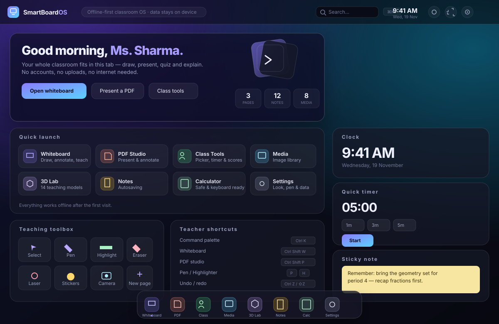
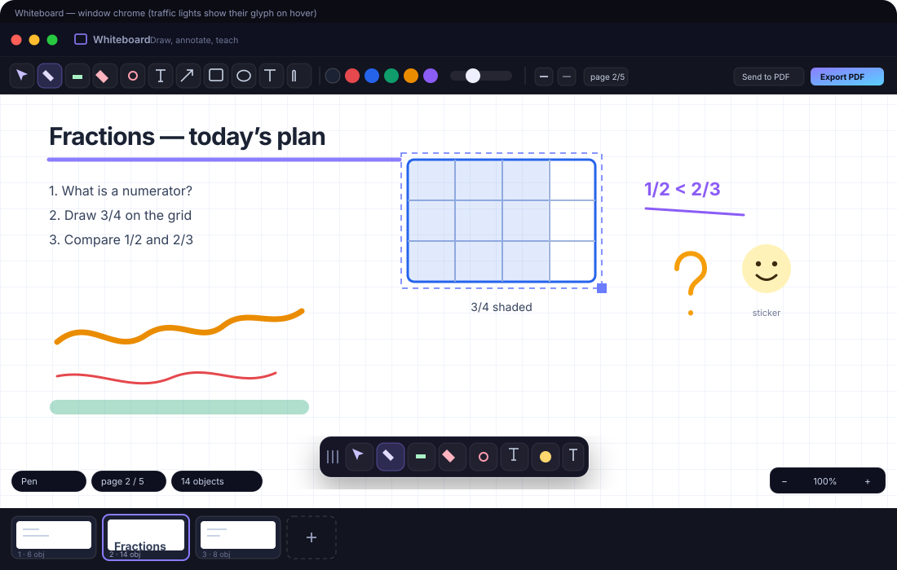

# SmartBoardOS

**The teacher's hub — an offline-first classroom OS that runs entirely in your browser.**
No backend, no accounts, no uploads, no analytics, and zero network requests after the first visit.





---

## What is it?

SmartBoardOS feels like a small desktop operating system rather than a single web page: a boot
sequence, a glassy top bar with a live clock, a desktop with a hero, quick-launch grid, teaching
toolbox, widgets and a dock, plus a real window manager with draggable, resizable, minimisable
windows carrying macOS-style traffic lights.

Everything is **vanilla JavaScript ES modules** — no framework, no bundler, no build step. It ships as
static files that work from GitHub Pages (including a `/repo-name/` sub-path) and installs as a PWA.

## Apps

| App | What it does |
| --- | --- |
| **Whiteboard** | Pressure-aware pen, highlighter, eraser, laser, shapes, text, stickers, camera, select/move/scale, unlimited pages with live thumbnails, 6 page backgrounds, undo/redo, autosave, PNG and multi-page PDF export. |
| **PDF Studio** | Open local PDFs (drag & drop or picker), thumbnail sidebar, zoom, rotate, recent files stored on device, send any page to the whiteboard as an annotation background. |
| **Class Tools** | Random student picker with confetti, spinning name wheel, class timer with chime, stopwatch with laps, team scoreboard, dice. |
| **Media** | On-device image library in IndexedDB: upload, send to board, download, delete. |
| **3D Lab** | 14 three.js teaching models (solids + solar system, H₂O, CO₂, CH₄, DNA), orbit, pinch zoom, auto-spin, wireframe, teaching notes, snapshot → whiteboard. |
| **Notes** | Autosaving lesson notes, search, trash with restore, Markdown export. |
| **Calculator** | Keyboard-friendly, live preview, history, and a real recursive-descent parser — never `eval`. |
| **Settings** | Theme, 5 accents, 4 wallpapers, motion; teacher name and 24-hour clock; pen & palm panel with camera test; install button, offline badge, JSON backup and full reset; about. |

## Quick start

Because the app uses ES modules and a service worker, serve it over HTTP (opening `index.html`
directly from the filesystem blocks modules in most browsers):

```bash
# any static server works
python3 -m http.server 8080
# then open http://localhost:8080
```

Camera features need a secure context: `https://` or `http://localhost`.

## Deploy to GitHub Pages

1. Push this repository to GitHub.
2. In **Settings → Pages → Build and deployment**, choose **Source: GitHub Actions**.
3. The workflow at `.github/workflows/deploy.yml` deploys the repo root on every push to `main`
   (and can be run manually from the Actions tab).
4. Your OS is live at **https://analoggeek.github.io/SmartboardOS/**. All URLs are relative (`./js/...`), so a
   sub-path just works, and `.nojekyll` keeps GitHub from filtering any file.

If the deploy workflow finishes green but nothing is published, Pages has not been switched on yet:
open **Settings → Pages**, set *Source* to **GitHub Actions**, then re-run the workflow (or push again).

> First load needs the network; after that the service worker serves the whole OS offline. Bump
> `VERSION` in `sw.js` for every release so old caches are dropped cleanly.

## Pen & tablet support

Works with Wacom, Huion, XP-Pen, Apple Pencil, S Pen, USI pens and touch-laptop digitizers because it
reads standard Pointer Events:

- **Pressure** — every stroke point stores a `p` value and pen strokes render variable-width segments
  with round joins, so lines thicken with pressure. The highlighter keeps a constant width so
  overlapping alpha does not bead.
- **Tilt** — widens highlighter strokes.
- **Software palm rejection** — ignores contacts that are too large (contact size), that happen while
  the pen is down, or that land within a configurable delay (0–2000 ms, default 900) after the pen
  lifts. Settings: palm guard **Auto / Strong / Off**, pressure on/off, tilt on/off, finger drawing
  on/off, smoothing 0–80 %.
- **Multi-touch** pinch-zoom and two-finger pan still work on touch-only devices.

## Keyboard shortcuts

| Shortcut | Action |
| --- | --- |
| `Ctrl/⌘ K` | Command palette |
| `Ctrl/⌘ Shift W` | Whiteboard |
| `Ctrl/⌘ Shift P` | PDF Studio |
| `Ctrl/⌘ Shift T` | Class Tools |
| `F` | Fullscreen |
| `S P H E L A R O T Z V` | Select · Pen · Highlighter · Eraser · Line · Arrow · Rectangle · Ellipse · Text · Laser · Pan |
| `[` `]` | Brush size |
| `Ctrl/⌘ Z` / `Ctrl/⌘ Shift Z` | Undo / redo |
| `Ctrl/⌘ S` | Save board |
| `Delete` / `Ctrl/⌘ D` / `Esc` | Delete / duplicate / deselect selected object |
| `←` `→` | Page navigation in PDF Studio |

## Where your data lives

- **IndexedDB** — board pages, uploaded images, PDF files, recents.
- **localStorage** — settings, notes, student list, team scores, sticky note, widget list, window
  geometry, plus a mirror of the board that is flushed on `pagehide`.

Nothing is uploaded. There are no third-party requests at runtime; pdf.js, jsPDF and three.js are
vendored under `vendor/` and icons and emoji are bundled vector art. The service worker refuses to
handle cross-origin requests.

## Project structure

```
index.html                 shell: boot, top bar, desktop, dock, palette, toasts
manifest.webmanifest       PWA manifest + shortcuts
sw.js                      offline-first service worker with VERSION
.nojekyll                  GitHub Pages passthrough
css/styles.css             design system, shell, windows, apps, responsive
js/
  main.js                  bootstrap, app registry, dock, palette, shortcuts, PWA
  wm.js                    window manager (drag/resize/minimise/maximise)
  widgets.js               desktop widgets (clock, timer, sticky, dice)
  db.js                    IndexedDB + localStorage helpers
  utils.js                 DOM/toast/confetti/sound/file helpers
  icons.js                 inline SVG icon set
  pen.js                   pressure/tilt reading + software palm rejection
  camera.js                camera sheet
  emoji-data.js            ~80 emoji as bundled SVG data URIs
  apps/
    whiteboard.js  pdf.js  media.js  class.js  lab3d.js
    notes.js  calculator.js  settings.js
vendor/                    pdf.js 3.11.174 · jsPDF 2.5.1 · three.js 0.160.1
assets/icons/              favicon + 192/512/maskable/apple-touch icons
docs/                      preview artwork
.github/workflows/deploy.yml
```

## Build quality notes

- Canvas 2D with DPR-aware rendering, `ResizeObserver`, coalesced pointer events and a
  `requestAnimationFrame` dirty-flag loop; images and emoji art are decoded once and cached.
- Undo history is page-scoped and capped at 60 steps; every gesture (draw, move, scale, text,
  duplicate, delete, clear) is undoable.
- All icon-only controls have `title` + `aria-label`; modals close on `Esc`; toasts announce via a
  live region; `[hidden]` always wins; focus rings use `:focus-visible`.
- Responsive breakpoints at 1080 / 820 / 640 / 560 px. Below 820 px windows open full-screen and
  toolbars become a single horizontally scrollable row.
- Traffic-light glyphs (×, −, +) only appear on hover or keyboard focus.

## Licences

SmartBoardOS is MIT licensed. Bundled third-party libraries keep their own licences:
pdf.js 3.11.174 (Apache-2.0), jsPDF 2.5.1 (MIT), three.js 0.160.1 (MIT).
